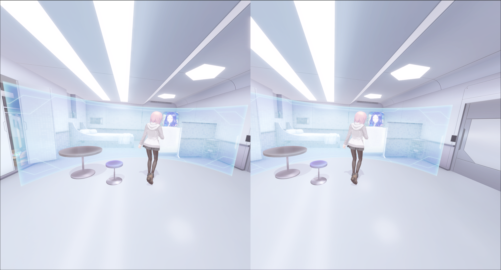
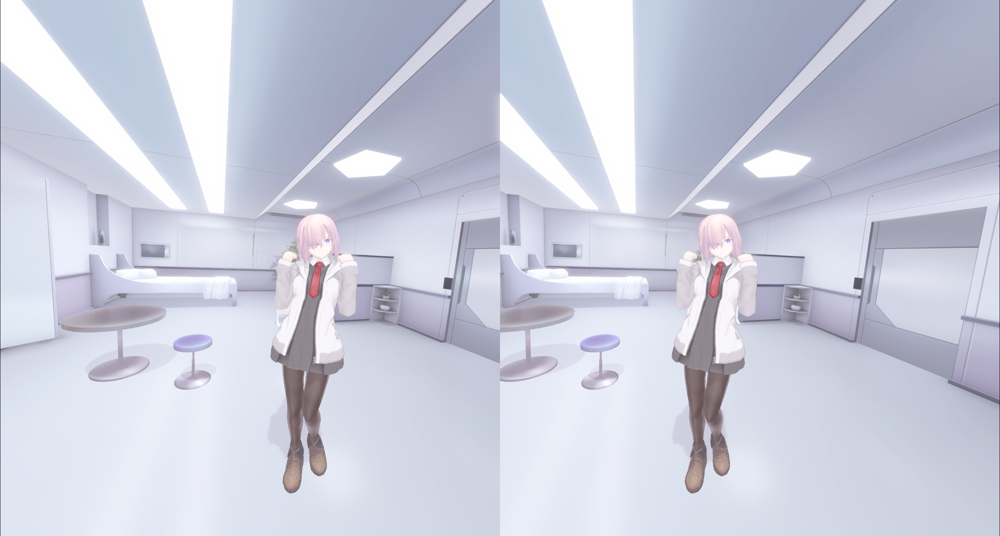
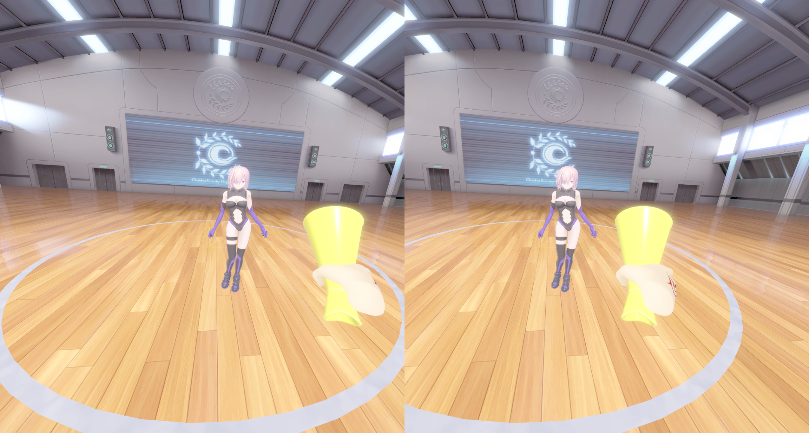

# Screenshots

Captured from the desktop mirror window, which shows both eyes as the headset gets them
(Windows Mixed Reality headset through SteamVR's OpenXR runtime).

|      Fate/Grand Order VR feat. Mash Kyrielight by DELiGHTWORKS / Aniplex       |                                                                                  |
| :----------------------------------------------------------------------------: | :------------------------------------------------------------------------------: |
|  |  |
|  | |

Fate/Grand Order VR feat. Mash Kyrielight © TYPE-MOON / FGO PROJECT.

Each picture comes in two layouts:

- `*-parallel.png`: the left eye on the left, as in the headset (parallel viewing or a stereo
  viewer).
- `*-crosseye.png`: the eyes swapped, for cross-eyed free viewing:
  [room](./fgo-vr-room-1-crosseye.png), [room, other angle](./fgo-vr-room-2-crosseye.png),
  [hall](./fgo-vr-hall-crosseye.png).
